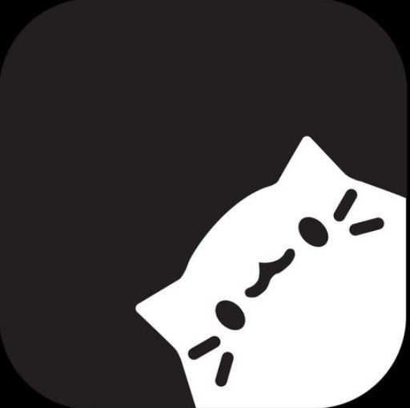
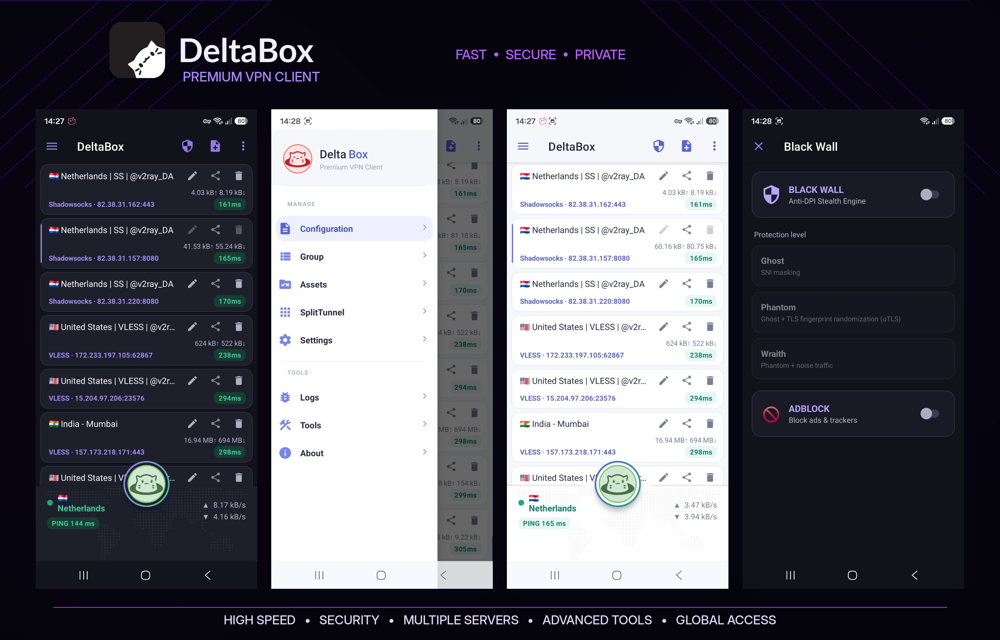

  

<h1 align="center">DeltaBox</h1>

Fast · Secure · Private

  
  
  

<b>English</b> · <a href="README_fa.md">فارسی</a>

## What is DeltaBox?

DeltaBox is an updated fork of NekoBox for Android, rebuilt on a newer sing-box core and refreshed
with a new look, default settings tuned from real-world use, and privacy tools built in rather than
bolted on: built-in ad and tracker blocking, and an anti-DPI engine (Black Wall) for networks that
actively interfere with normal proxy traffic.

  

## Core

**sing-box** `1.15.0-alpha.13`, with DeltaBox's own compatibility and routing patches re-applied on
every core update (geosite/geoip rule-set paths, selector hooks, connection-closing hooks).

## Protocols

| | |
|---|---|
| VMess / VLESS *(including Reality)* | Trojan / Trojan-Go |
| Shadowsocks | Hysteria |
| NaïveProxy | ShadowTLS |
| TUIC | Mieru |
| AnyTLS | WireGuard |
| SSH | SOCKS / HTTP *(outbound or chain link)* |

Configs can be imported from share links, subscriptions, QR codes, or raw sing-box JSON. Proxies can
also be chained through one another.

## Features

- **Black Wall** — an anti-DPI stealth engine with three levels: *Ghost* (TLS SNI camouflage against
  a whitelisted, never-blocked CDN domain), *Phantom* (Ghost plus randomized uTLS browser
  fingerprinting), and *Wraith* (Phantom plus periodic decoy HTTPS traffic alongside the tunnel, so
  the traffic pattern reads as ordinary browsing). Never applied to REALITY outbounds, which already
  do their own TLS camouflage.
- **AdBlock** — blocks ad and tracker domains at the routing layer (a single sing-box reject rule),
  using a built-in list plus downloadable hosts-format lists; proxy servers themselves are never
  blocked.
- Per-app split tunneling
- Groups and subscriptions, with per-group update and URL test
- Asset manager for geoip/geosite rule sets
- Logs, TCP test, and a live traffic graph
- Local and WebDAV backup/restore of profiles, groups and settings
- Material design, light and dark, in multiple languages

## Download

APK for your device from [Releases](https://github.com/rc3vr467/DeltaBox/releases/latest)
(`arm64-v8a` for almost every phone, `armeabi-v7a` for older ones, `x86` and `x86_64` for Intel
tablets and emulators).

## Credits

DeltaBox is a fork of [NekoBoxForAndroid](https://github.com/MatsuriDayo/NekoBoxForAndroid), itself
built on [SagerNet](https://github.com/SagerNet/SagerNet). It stands on
[sing-box](https://github.com/SagerNet/sing-box). The Black Wall engine is ported from
[ChimeraWire](https://github.com/inferno1978/Chimera-Project)'s anti-DPI engine, adapted to
sing-box's config builder in place of Xray JSON. Ad and tracker blocking uses
[AdAway](https://github.com/adaway/adaway) and [MahsaNG](https://github.com/GFW-knocker/MahsaNG)
block lists.

## License

[GPL-3.0](LICENSE).
