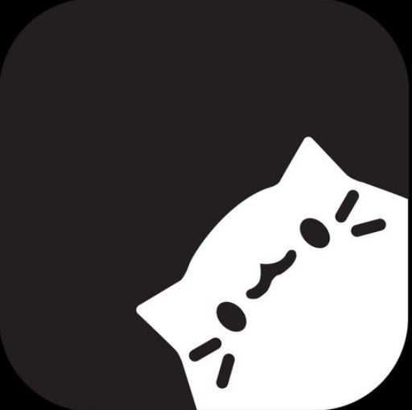
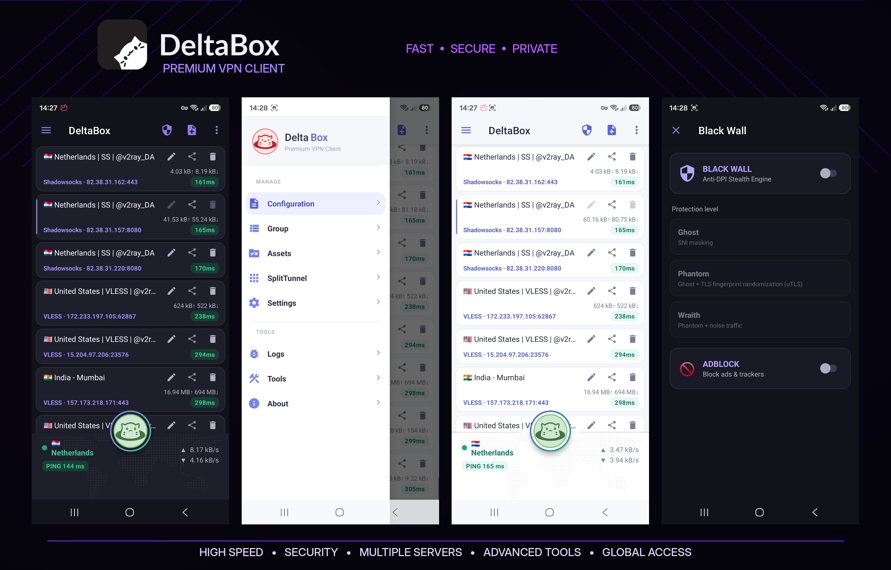

  

<h1 align="center">دلتاباکس (DeltaBox)</h1>

سریع · امن · خصوصی

  
  
  

<a href="README.md">English</a> · <b>فارسی</b>

## دلتاباکس چیست؟

دلتاباکس نسخه‌ی به‌روزشده‌ای از کلاینت NekoBox برای اندرویده که بر پایه‌ی هسته‌ی جدیدتر sing-box
بازسازی شده و با ظاهری تازه، تنظیمات پیش‌فرض بهینه‌شده بر اساس تجربه‌ی واقعی استفاده، و ابزارهای
حریم خصوصی که از ابتدا در برنامه تعبیه شده‌اند عرضه می‌شود: مسدودسازی تبلیغات و ردیاب‌ها، و یک
موتور ضد-DPI (دیوار سیاه) برای شبکه‌هایی که به‌طور فعال مانع ترافیک معمول پروکسی می‌شوند.

  

## هسته

**sing-box** نسخه‌ی `1.15.0-alpha.13`، که در هر به‌روزرسانی هسته، پچ‌های اختصاصی دلتاباکس
(مسیرهای rule-set جئوسایت/جئوآی‌پی، قلاب‌های انتخابگر، قلاب‌های بستن اتصال) دوباره روی آن اعمال
می‌شود.

## پروتکل‌های پشتیبانی‌شده

| | |
|---|---|
| VMess / VLESS *(شامل Reality)* | Trojan / Trojan-Go |
| Shadowsocks | Hysteria |
| NaïveProxy | ShadowTLS |
| TUIC | Mieru |
| AnyTLS | AmneziaWG |
| SSH | SOCKS / HTTP *(به‌عنوان خروجی یا حلقه‌ی زنجیره)* |

تنظیمات را می‌توان از طریق لینک اشتراک‌گذاری، سابسکریپشن، کد QR یا فایل JSON خام sing-box وارد کرد.
همچنین امکان زنجیره کردن پروکسی‌ها از طریق یکدیگر وجود دارد.

## امکانات

- **دیوار سیاه (Black Wall)** — یک موتور ضد-DPI با سه سطح: *Ghost* (استتار SNI با یک دامنه‌ی CDN
  مجاز و هرگز مسدودنشده)، *Phantom* (Ghost به‌علاوه‌ی جعل تصادفی اثر انگشت مرورگر با uTLS)، و
  *Wraith* (Phantom به‌علاوه‌ی ترافیک فریب‌دهنده‌ی دوره‌ای HTTPS همراه با تونل، به‌طوری‌که الگوی
  ترافیک شبیه مرور عادی وب به‌نظر برسد). هرگز روی خروجی‌های REALITY اعمال نمی‌شود، چون آن‌ها خودشان
  استتار TLS مخصوص به خود را انجام می‌دهند.
- **AdBlock** — مسدودسازی دامنه‌های تبلیغاتی و ردیاب در لایه‌ی مسیریابی (یک قانون reject ساده در
  sing-box)، با استفاده از یک لیست داخلی به‌علاوه‌ی لیست‌های قابل دانلود با فرمت hosts؛ خود سرورهای
  پروکسی هرگز مسدود نمی‌شوند.
- تقسیم تونل بر اساس هر برنامه (Per-app split tunneling)
- گروه‌ها و سابسکریپشن‌ها، با قابلیت آپدیت و تست URL برای هر گروه
- مدیریت دارایی‌ها (asset) برای rule-setهای جئوآی‌پی/جئوسایت
- لاگ‌ها، تست TCP، و نمودار زنده‌ی ترافیک
- پشتیبان‌گیری و بازیابی محلی و WebDAV از پروفایل‌ها، گروه‌ها و تنظیمات
- طراحی متریال، روشن و تیره، با پشتیبانی از چند زبان

## دانلود

فایل APK متناسب با دستگاهتان را از [Releases](https://github.com/rc3vr467/DeltaBox/releases)
دانلود کنید (`arm64-v8a` برای تقریباً همه‌ی گوشی‌ها، `armeabi-v7a` برای گوشی‌های قدیمی‌تر، `x86` و
`x86_64` برای تبلت‌های اینتلی و شبیه‌سازها).

## قدردانی

دلتاباکس فورکی از [NekoBoxForAndroid](https://github.com/MatsuriDayo/NekoBoxForAndroid) است، که
خودش بر پایه‌ی [SagerNet](https://github.com/SagerNet/SagerNet) ساخته شده. این پروژه بر پایه‌ی
[sing-box](https://github.com/SagerNet/sing-box) استوار است. موتور دیوار سیاه برگرفته از موتور
[ضد-DPI پروژه‌ی ChimeraWire](https://github.com/inferno1978/Chimera-Project) است که برای کار با
کانفیگ‌ساز sing-box (به‌جای JSON مخصوص Xray) تطبیق داده شده. مسدودسازی تبلیغات و ردیاب‌ها با
استفاده از لیست‌های [AdAway](https://github.com/adaway/adaway) و
[MahsaNG](https://github.com/GFW-knocker/MahsaNG) انجام می‌شود. پشتیبانی از WireGuard از طریق
[AmneziaWG](https://github.com/amnezia-vpn/amneziawg-go)، یک فورک ضد-DPI از WireGuard، فراهم شده
است.

## مجوز

[GPL-3.0](LICENSE).
